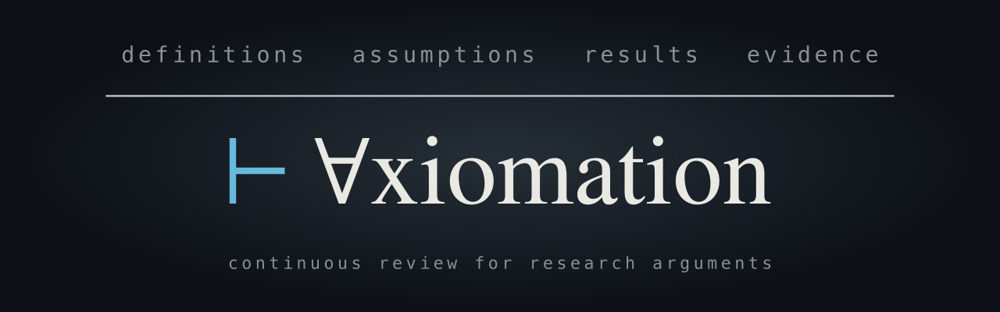

<p align="center">
  
</p>

# axiomation

**Continuous review for research arguments.**

axiomation builds the argument graph of a paper, automatically, and keeps
it current as the paper changes. It shows what each claim rests on, which
claims rest on nothing, and which earlier checks an edit has undone.

## Why

AI has driven down the cost of producing plausible research far more than
the cost of scrutinizing it. axiomation aims to narrow that gap from both
sides:

```text
Effort                 Without axiomation   With axiomation
Write research         ████████████         ███████
Write learned twaddle  ████                 ███████████████████████
Review either          ████████████         ████
```

For solid research, this means less repeated work: a check made once
stays valid until something it rests on changes. For a fragile edifice,
the graph is a load test: every claim must rest on a result, an
assumption, a source or a computation, and a claim that rests on nothing
is shown as a gap. Break a support, and everything that relied on it is
marked.

Review becomes easier in either case. A reviewer follows the support for
a claim, reads the evidence and the open findings, and sees what changed
since the last reading. Scrutiny goes where the argument moved.

The ambition is to make maintaining a house of cards harder than building
a sound argument brick by brick.

## What it does

A paper's argument is a graph its text only implies. An edit to a
definition can change what a theorem twenty pages later means without
changing a word of it. axiomation makes the graph explicit:

- **The graph, from the text alone.** Every block of a LaTeX or Markdown
  paper (a paragraph, a statement, a proof, a display) becomes a node,
  and the direct reliances between blocks become edges, which a person
  or an agent can correct. The paper needs no labels or markup;
  axiomation never writes it.
- **The gaps.** Every claim gets a standing: justified by another block,
  supported in its own block (an argument or a citation there), a
  restatement of another claim, conjectured, or unsupported. The
  unsupported claims are the gaps the graph exists to show.
- **The reach of an edit.** An update puts to the agents only what the
  edit touched, then carries the change along the graph to the blocks
  whose meaning or support it could move, and marks each one until it is
  read again.
- **Reviews.** Agents read the paper for one question each: is each
  proof valid, does each cited work say what the paper says it does,
  does each script compute what the text prints, is the result already
  known, what would a referee meet.
- **Judgments that lapse.** A judgment, from a person or an agent, is
  stored with the graph, together with the exact text it read. When that text
  or what it rests on changes, the judgment lapses; its history stays. A
  person's judgment decides over an agent's.
- **A verdict.** `check` runs the paper's gates (no unsupported claim,
  no open defect, no unused premise, …; [the model](docs/model.md) § 11)
  over the graph and the judgments, and names each item that stands in
  the way.

Agents give the judgment; deterministic code does everything else, so the
same text with the same answers gives the same graph, and every change's
reach is computed.

## Install

Python 3.12 or later and `ssh-keygen` (OpenSSH, on macOS and most Linux
systems already), with which axiomation signs a person's filings and
encrypts each paper's record for their keys. It is developed and tested
on macOS and Linux.

```sh
uv tool install axiomation   # or: pipx install axiomation
axiomation keys --make       # once: the keys that sign and encrypt each paper's record
```

`keys --make` runs at a terminal: it asks the passphrase that guards
the signing key, and shows a recovery key once, to be kept offline. The
recovery key opens every record written with these keys if they are
lost.

The agents run on [Claude Code](https://claude.com/claude-code)
(`claude` on the `PATH`, logged in): the default profile, `standard`,
puts every agent there. [OpenCode](https://opencode.ai) is
experimental: some review sessions do not run on it, and it is refused
unless `AXIOMATION_EXPERIMENTAL_OPENCODE=1` is set.

The cited works are read from their PDFs on the person's machine; no
online service is needed. The optional services (a corpus in Qdrant, an OCR engine,
the lookups of cited works) and the user file that holds their settings
are in [the guide](docs/guide.md#1-set-up) § 1.

## Use

A paper is a directory. Its record, the **store** (the graph's states,
the agents' answers, the judgments), is kept inside it in `axiomation/`
and committed with it. The example, `examples/weak-law/`, is a one-page
paper with a few faults on purpose ([what a run finds](examples/README.md));
its whole loop costs about $3, and each `--budget` caps its run:

```sh
git clone --depth 1 https://github.com/vvhg1/axiomation    # for the example
cp -R axiomation/examples/weak-law ~/weak-law
axiomation build ~/weak-law --budget 5                        # the graph
axiomation open ~/weak-law                                    # what is open: unsupported claims, flags, findings
axiomation review ~/weak-law --session argument --budget 5    # each claim and proof read by an agent
axiomation check ~/weak-law                                   # whether the paper passes, and what stands in its way
axiomation view ~/weak-law --open                             # the viewer, on 127.0.0.1
# in ~/weak-law/paper.md, weaken ass:independent to pairwise uncorrelated (examples/README.md has the words), then
axiomation update ~/weak-law --budget 5                       # the graph carried onto the new text
axiomation changes ~/weak-law                                 # what the edit changed, and what lapsed
axiomation review ~/weak-law --session argument --budget 5    # what lapsed, read again
```

The same commands run on any paper's directory; `sync` runs the update
and the reviews as one round, then shows the inbox: the decisions left
to the person. `--dry-run` prices a run and
stops: it asks no agent and keeps nothing, so a dry `build` leaves no
graph for the commands after it. Every command's flags are in its `--help`; [the
guide](docs/guide.md) takes a paper through each task.

The edit weakens an assumption and looks harmless. Every judgment that
rests on it lapses, and the review reads those again (real output; `⋮`
and `…` mark what is cut):

```text
$ axiomation changes ~/weak-law
⋮
deltas (6):
  ass:independent  Δ widened — independence replaced by pairwise uncorrelatedness, a weaker premise: …
  thm:weak-law  Δ strengthened — the same bound and limit are now claimed under the weaker hypothesis …
⋮
lapsed (14):
  ⋮
  true · "the probability in \cref{thm:weak-law} decays exponentially in $n$"  lapsed at f9ac973c5c2b1d69: meaning, thm:weak-law has a Δ that carries: strengthened

$ axiomation show ~/weak-law rem:exponential
⋮
judgments (2):
  true · "the probability in \cref{thm:weak-law} decays exponentially in $n$"  held: contradicted (computational) by claude-code 2.1.319 claude-opus-5-5, 5d01a4b856de-1-12
    evidence 5d01a4b856de-1-12: … ass:independent now asks only pairwise uncorrelatedness, and under it, values in [0, 1] do not give exponential decay. …
```

Before the edit, the same remark was verified by Hoeffding's
inequality, which needs independence. [The model](docs/model.md) § 5 gives the rule
an edit's reach follows.

## Status

axiomation is an early tool, and its agents are not infallible. A graph
sometimes misses a reliance or holds a wrong one, and a review sometimes
misjudges a block. Even so, the graph makes explicit far more of an
argument than its text does. What the agents get wrong can be
corrected by hand: blocks, edges and judgments can all be edited, and a
person's judgment decides over an agent's.

The store does the rest. A check holds until something it rests on
changes. Then it lapses, and an agent reads it again. This narrows where to look;
it does not promise that nothing is missed.

Errors are weighed by kind. A claim called supported when it is not is
the error that matters; a false alarm is tolerated.

- **Papers:** developed and tested on math-heavy papers in LaTeX or
  Markdown.
- **Agents:** Claude, through Claude Code, in the `standard` profile. The
  `cheap` profile runs on OpenCode and is experimental.
- **Cost:** a build is a paid model run; an update costs in proportion
  to the edit. `--dry-run` estimates it; the estimate is rough, and low
  for a build, until the paper's own runs have taught it ([the
  guide](docs/guide.md) § 2).
- **Proofs:** a review is an agent's reading, not a formal proof check.
- **Viewer:** tables and custom macros show as source, references
  without their numbers, and hard-wrapped paragraphs as their source
  lines.

## Docs

- [The guide](docs/guide.md): axiomation in a paper's repository, for a
  person or an agent: set up, build, read, review, check, update,
  correct.
- [The model](docs/model.md): what the graph is: blocks, roles, edges,
  standings, change and reach, the states a store keeps, judgments, and
  what counts as established.
- [The architecture](docs/architecture.md): the components, the question
  contract, the hosts, the stores, the exchange format.
- [The OCR contract](docs/ocr.md): what a service must answer to read
  scanned pages of the cited works.

## Development

In a checkout, `uv sync` installs the package, the `library` extra and
the dev tools. `make check` runs ruff and the offline suite (Node 22 or
later on `PATH` for the viewer's tests, `tesseract` for the ingest's);
`make test-core` runs the suite
without the `library` extra. Contributors start at [CONTRIBUTING.md](CONTRIBUTING.md),
their agents at [AGENTS.md](AGENTS.md); [CHANGELOG.md](CHANGELOG.md) says
what each release changed.

## License

Apache License 2.0; the full text is in [LICENSE](LICENSE). It is
provided as is, without warranty: a passing check does not guarantee
that a paper is correct. Its
dependencies, and the `library` extra's, are third-party packages under
their own licenses.
The viewer bundles [KaTeX](https://github.com/KaTeX/KaTeX) (MIT) and
[elkjs](https://github.com/kieler/elkjs) (EPL-2.0), unchanged; their
licenses, versions and sources are in
[`src/axiomation/viewer/page/vendor/`](src/axiomation/viewer/page/vendor/MANIFEST.toml).
